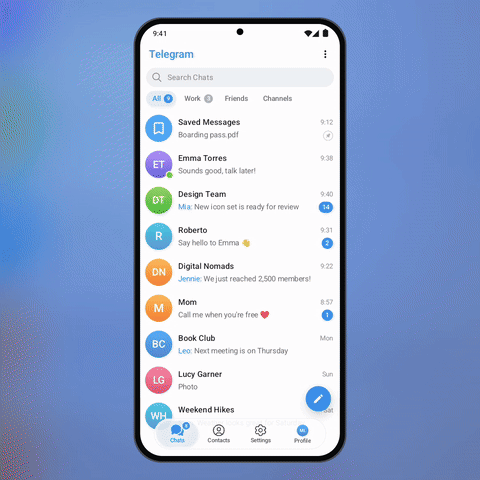

# 💤 Snooze Chat

Swipe a chat to the left, pick **In 1 hour / This evening / Tomorrow morning / Next week**,
and it leaves your list. A "Snoozed" row (like Archive) shows what is waiting. When the time comes,
the chat jumps back to the top with a **Reminder** badge and an in-app banner.

<p align="center"></p>

<p align="center"><b>&#9654;&#65039; <a href="demo.mp4">Full-quality video (demo.mp4)</a></b> &middot; Telegram for Android 12.4 design &middot; Android 8+</p>

## Why

Mute and Archive are forever-ish; pinned chats get noisy. People already use "mark as unread"
as a reminder. Snooze says what they mean: *not now, but don't let me forget*.

## How it works

- `SnoozeController` stores `until` and `since` per dialog locally (no server state),
  offers presets relative to now, and wakes chats in `check()`.
- `scheduleAlarm()` uses `AlarmManager.setWindow` so the chat comes back even when the app is closed.
- `SwipeActionLayout` is the swipe-left action with the threshold haptic, as in DialogsActivity.

## Integration into Telegram for Android

| Where | What |
|---|---|
| `DialogsActivity` swipe actions (`SwipeGestureSettingsView`) | add **Snooze** to the list of swipe actions |
| `DialogsAdapter` / `MessagesController.getDialogs` | skip dialogs where `isSnoozed(id)`; show one "Snoozed" cell at the top while any exist |
| `NotificationsController` | treat a snoozed dialog as muted until it wakes |
| `ApplicationLoader` / a `BroadcastReceiver` | on the alarm call `check()`, post a local notification and move the dialog up |
| `DialogCell` | the orange clock badge and the "Reminder" label for a dialog that just woke |

Files: [`SnoozeController.java`](snooze-chat/src/main/java/org/telegram/ui/Components/SnoozeController.java),
[`SwipeActionLayout.java`](snooze-chat/src/main/java/org/telegram/ui/Components/SwipeActionLayout.java).
In the video the clock is fast-forwarded by one hour (a demo-only control).

## Build and run

Requirements: JDK 17 and the Android SDK (platform 36). Point Gradle at the SDK with
`local.properties` (`sdk.dir=/path/to/Android/sdk`) or `ANDROID_HOME`.

```
./gradlew :snooze-chat:assembleDebug
adb install snooze-chat/build/outputs/apk/debug/snooze-chat-debug.apk
```

The app opens on the demo screen and works by hand. For the presentation look of the video:

```
adb shell am start -n org.telegram.lab.snoozechat/.MainActivity --ez stage true --ez autoplay true
```

## Project layout

| Path | What it is |
|---|---|
| `snooze-chat/src/main/java/org/telegram/ui/Components/` | **the feature itself**, drop-in for Telegram's `TMessagesProj` (Android SDK + `AndroidUtilities` only) |
| `snooze-chat/src/main/java/org/telegram/lab/snoozechat/` | the demo screen and the scripted demo used for the video |
| `core/` | Telegram 12.4-style UI the demo is built on: chat screen, bubbles, composer, sheets, menus, Telegram's own icons |

## License

GPL-2.0, same as Telegram for Android, whose icons are included in `core`.